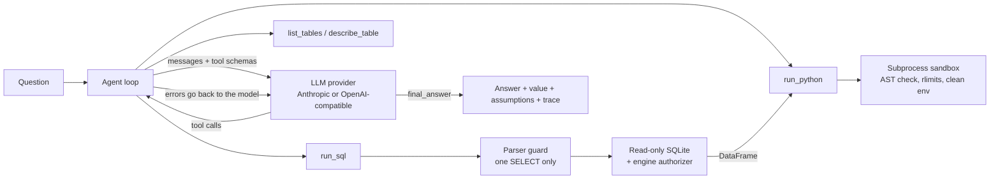

# Agentic AI Data Analyst

An agent that answers business questions by writing and running its own SQL and Python. It uses native LLM tool calling: the model inspects the schema, queries the data, reads any errors, fixes its own mistakes, and returns a structured answer that a benchmark can score.

```
$ analyst-agent "Which genre generated the most revenue, and how concentrated is revenue across genres?" --trace
```

## How it works



Design choices:

- **Tool errors are model input.** A failed query comes back as an `is_error` result, so the model corrects itself instead of the run crashing.
- **SQL results flow into Python.** `run_sql` saves a DataFrame under a name, and `run_python` receives it as a global, so full results don't have to pass through the prompt.
- **Answers are structured.** `final_answer` carries a machine-readable `value`, an `answerable` flag and stated assumptions, so scoring doesn't rely on parsing prose.
- **Small models get a way to finish.** Local models often state the answer in prose or write `final_answer` as plain JSON. The agent then offers only `final_answer`, accepts valid JSON from the text, and flags those answers in the results.
- **Every run has budgets.** Steps, tool errors, tokens and wall-clock time are all capped, and the run's status records which limit stopped it.
- **Providers are swappable.** One neutral message format is translated by small adapters, so the loop contains no provider-specific logic.

## Results

### Guardrails (measured, no LLM needed)

`python -m eval.guard_benchmark` runs 37 hand-written attacks against a copy of the database, then compares its hash afterwards.

| Check | Result |
|---|---|
| Attacks that got through both layers | 0 of 37 |
| Stopped by the parser guard | 36 |
| Missed by the parser, stopped by the engine authorizer | 1 (`pragma_table_info` used as a table function) |
| Blocked with the parser bypassed entirely | 34 of 34 |
| Legitimate gold queries wrongly rejected | 0 of 32 |
| Database file changed | No |

The attack list is my own, so this is a regression suite rather than a security audit. The one parser miss is why the second layer exists. Both the attacks and the results are in [`eval/guard_benchmark.py`](eval/guard_benchmark.py) and [`results/guard_benchmark.json`](results/guard_benchmark.json).

### Agent accuracy (run this with a model of your choice)

**This benchmark has not been run against a live model yet, so no accuracy number is claimed.** The harness and adapters are tested with scripted responses and a fake HTTP server, which proves the plumbing but not model performance.

```bash
export ANTHROPIC_API_KEY=...
python -m eval.run_eval --provider anthropic --model claude-sonnet-5-5
```

Or run it for free on your own machine with [Ollama](https://ollama.com), using a model that supports tool calling:

```bash
ollama pull qwen3:8b
printf 'FROM qwen3:8b\nPARAMETER num_ctx 16384\n' > /tmp/Modelfile
ollama create analyst-model -f /tmp/Modelfile
export OPENAI_BASE_URL=http://localhost:11434/v1
python -m eval.run_eval --provider openai --model analyst-model --max-seconds 600
```

Either way, this writes `results/benchmark.md` with the table below filled in, and `results/benchmark.json` with a full trace per question. The table records which model produced the scores, and a small local model will likely score lower than a large hosted one.

| Category | Questions | What it tests |
|---|---:|---|
| aggregation | 8 | Single-table counts, sums and filters |
| join | 10 | Multi-table joins, anti-joins |
| multi_step | 8 | CTEs, window functions, derived metrics |
| python | 6 | Regression, correlation, Gini, growth rates |
| refusal | 6 | Missing data and write requests that must be declined |

Expected answers are computed from gold SQL at run time. Numbers must match within 1%. Refusing an answerable question counts as wrong, and so does answering one that should be refused. Questions are written by hand for this database, so the score shows how the agent does on this benchmark and doesn't generalize the way a public text-to-SQL benchmark would.

## Quick start

```bash
python -m venv .venv && source .venv/bin/activate
pip install -e '.[dev]'
python scripts/download_data.py    # Chinook sample database, pinned and checksummed
pytest -q                          # needs no API key

export ANTHROPIC_API_KEY=...       # or: export OPENAI_API_KEY=... and use --provider openai --model <name>
analyst-agent "What was the revenue trend by year? Save a chart." --trace
```

`--provider openai` works with any Chat Completions server that supports tools. Set `OPENAI_BASE_URL` to point at vLLM, Ollama or another compatible server.

## Security model

| Layer | Protects against |
|---|---|
| sqlglot parser allowlist | Writes, multiple statements, denied functions, system tables |
| `mode=ro` connection + SQLite authorizer | Anything the parser misses, enforced by the engine |
| Row limit and query deadline | Huge results and runaway recursive queries |
| Python AST allowlist | Non-analysis imports, `eval`/`open`, private attributes, pandas file I/O |
| Subprocess with rlimits and a clean environment | Runaway CPU or memory, and leaking API keys to generated code |

**Known limits:** the memory limit uses `RLIMIT_AS`, which Linux enforces and macOS doesn't. On a Mac, generated code is still bound by the CPU limit and timeout, but not by a memory cap, so deploy on Linux. Also, static checks on Python can be bypassed by a determined attacker, so the Python sandbox is defence in depth, not a security boundary. A multi-tenant deployment should also run it in a container or gVisor with no network.

## Project layout

```
src/analyst_agent/
  agent.py       the loop, budgets, trace
  llm.py         Anthropic and OpenAI-compatible adapters, retries
  tools.py       tool schemas and executor
  sql_guard.py   parser guard and read-only database
  sandbox.py     Python static check and subprocess runner
  cli.py         command line
eval/            questions, scoring, benchmark runner, guard benchmark
tests/           loop, adapters, guards, and the benchmark itself
```

## Data

[Chinook](https://github.com/lerocha/chinook-database) (MIT) is a sample digital music store with 11 tables and 412 invoices. It's downloaded at a pinned commit, not vendored.
